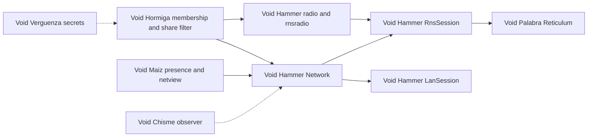

# The line, on 2026-10-18

**Void Hammer reaches devices and runs the sync engine. Void Palabra owns what
crosses. Void Maiz owns what networking looks like. The application decides who
may join and what may leave.**

This replaces Void Maiz's line of 2026-09-22 (“Void Maiz owns reaching a
device”). The narrower Q30 line is unchanged and now describes Void Maiz
exactly. See
[VoidHammer networking](VoidHammer:/concepts/networking.md) and
[Void Maiz networking](VoidMaiz:/concepts/networking.md).

| owner | what it owns | current code |
|---|---|---|
| **Void Hammer** | reaching devices: sockets, LAN facts, join codes, Android's multicast lock, the radio holiday, the loopback radio; the sync engine: `Network`, `LanSession`, `RnsSession`, `RadioBridge` | `VoidHammer/net/` (`voidhammer_reach`, `voidhammer_net`) |
| **Void Maiz** | what networking looks like: presence, surfaces, marks, roster, claims, wires, `netview`, Allomone's `present`, the navigation bar | `voidmaiz/presence.hpp`, `claims.hpp`, `netview.hpp`, `wires.hpp`, `nav.hpp` |
| **Void Palabra** | what crosses: the sync session, merge, stream envelope, Reticulum, identity and entropy | `VoidPalabra/` |
| **Void Chisme** | watching and managing a running network | `VoidChisme/` (phase 0) |
| **Void Verguenza** | shared secrets, envelopes, approvals | `VoidVerguenza/` (single-device vault) |
| **Void Hormiga** | the database, who may join, the members registry, private tags, the share filter, what a join carries | this repository |

# What is built today

## Void Hammer

- `voidhammer_reach`: `lan.hpp` address and interface facts, the join code, the
  Android multicast lock, the radio holiday and its loopback stand-in.
- `voidhammer_net`: `Network` (one replica, one Palabra session per link,
  observe → persist → share → merge → splice, presence, conflicts, files,
  `resync`, counters), `LanSession` (beacon, Allow/Deny, idle death,
  `already_allowed`), `RnsSession` (Reticulum announces, link join, Allow/Deny,
  re-admit by proven identity), `RadioBridge` (LE pipe, Wi-Fi Direct UDP
  interface).
- The five tests — `lan_smoke`, `net_smoke`, `lanlink_smoke`, `radio_smoke`,
  `rnslink_smoke` — are green in Hormiga's build as of 2026-10-18.

## Void Palabra

Reticulum through `voidpalabra_reticulum`; pipes and runtime interfaces;
OS-seeded entropy; sync sessions over Reticulum links. No breaking change was
found for Hormiga's current use.

## Void Maiz

Presence, marks, roster, claims, wires and `netview` are unchanged. The
navigation bar is now `voidmaiz/nav.hpp`. The HTTP seam is
`voidmaiz/http.hpp`. The update client is `voidmaiz/update.hpp` and
`updateview.hpp`. The portable shell is `voidmaiz/app.hpp` /
`device.hpp` with `maiz_add_app`.

## Void Chisme and Void Verguenza

Chisme has a phase-0 library, application services, CLI and window. The
observer role and the Reticulum adapter are later phases. Verguenza has
`voidverguenza` (the envelope and record foundation) and a single-device desktop
vault; the client seam Hormiga needs (`describe`/`use`) is phase 2.

# What Hormiga uses today, and why it still compiles

Hormiga links the **old names**:

- [`CMakeLists.txt`](../../CMakeLists.txt:102) links `hormiga_sync` to
  `voidmaiz_lan`.
- [`CMakeLists.txt`](../../CMakeLists.txt:110), `335` and `407` test for and link
  `voidmaiz_net`.
- [`android/hormiga_android.cmake`](../../android/hormiga_android.cmake:37) does
  the same for the APK.

Void Maiz keeps those as interface targets over `voidhammer_reach` and
`voidhammer_net`, and keeps forwarding headers for `lan.hpp`, `net.hpp`,
`radio.hpp`, `rnsradio.hpp`, `rnslink.hpp` and `lanlink.hpp`. That is why the
2026-10-17 move did not break Hormiga. It is compatibility, not adoption.

The source sites are:

| old header | sites |
|---|---|
| `voidmaiz/lan.hpp` | [`src/sync/peer.cpp`](../../src/sync/peer.cpp:9), [`src/app/lan_presence.cpp`](../../src/app/lan_presence.cpp:5), [`src/ui/share.cpp`](../../src/ui/share.cpp:21), [`android/src/main_android.cpp`](../../android/src/main_android.cpp:31) |
| `voidmaiz/net.hpp` | [`src/app/lan_share.hpp`](../../src/app/lan_share.hpp:29) |
| `voidmaiz/radio.hpp` | [`src/app/lan_radio.cpp`](../../src/app/lan_radio.cpp:42), [`src/phone/phone_migos.cpp`](../../src/phone/phone_migos.cpp:30), [`android/src/main_android.cpp`](../../android/src/main_android.cpp:33) |
| `voidmaiz/rnsradio.hpp` | [`src/app/lan_radio.cpp`](../../src/app/lan_radio.cpp:46) |

# The two transports Hormiga actually runs

## The LAN sync is Hormiga's sealed session, not Reticulum

`sync/peer.*` and `app/lan_wire.*` own the multicast beacon, the X25519
handshake, the short authentication string, `secretstream`, the room key and
sealed presence. `app/lan_net.cpp` drives `maiz::Network` over that session. The
room key, not a Reticulum identity, is the membership boundary. This is the
path that carries an organization's member list today.

**Since later on 2026-10-18 the room is the database's**, not the folder's: the
key file lives in this device's keyring under the database's sync id, the key in
use is that file bound to the id, every member link proves it (`HZL1`) before
its first frame, and opening another database ends every link of the last one
on every transport. See [a database is its own room](/concepts/platform/database-separation.md).

## The radios use Reticulum, but not `RnsSession`

`app/lan_radio.cpp` drives `voidpalabra::reticulum::Node` and
`maiz::RadioBridge` directly. It advertises a room-derived tag, opens links only
to members in the registry, and proves the room key with HZP1 before any frame.
It compresses frames because a whole state on LE is expensive. `RnsSession` is
not used, so the radio and LAN paths have separate membership proofs. Both prove
the same per-database room, and a room change closes every radio link.

# The gate: Reticulum announces are public

`RnsSession::about_json` puts the application, device id, person's display name,
colour, host flag and the shared database's name into every announce. Announces
are public. Hormiga's LAN path seals presence to the room key precisely so
outsiders cannot read who is present. Moving LAN sync to `RnsSession` as it
stands would undo that.

This is [Q98](/developer_questions.md). The gate for any Reticulum transport
change is: **announces carry only the application and an opaque id, and names
travel inside the sealed presence.** The same change must be measured before
Hormiga switches its default.

# What was stale, and what remains

The documentation that stated the old ownership was corrected on 2026-10-18:
[LAN sharing](/concepts/platform/lan-sharing.md),
[Antfarm collaboration](/concepts/platform/antfarm/collaboration.md),
[radios](/concepts/platform/radios.md),
[mobile](/concepts/sections/mobile.md),
[Void Maiz uptake](/concepts/projects/void-maiz-uptake.md),
[Void Snape](/concepts/projects/void-snape.md),
[Void Chisme](/concepts/projects/void-chisme.md),
[Void Verguenza](/concepts/projects/void-verguenza.md), the
[project index](/concepts/projects/index.md), README, AGENT-GUIDE, CI, release
and the Android notes.

What remains is behaviour, not prose:

- Source includes and CMake targets still use the `voidmaiz_*` names (Q113).
- The Android CMake still links `voidmaiz_net`, the compatibility alias.
- CI has no Void Hammer clone, because Hammer has no public remote; the build
  says networking is absent (Q116).
- The navigation bar is available upstream but not adopted here (Q115).
- The Reticulum transport is gated on Q98 and Q114.
- The portable shell, the update client, Chisme's observer role and Verguenza's
  client seam are documented but not adopted.

# The approved order

No source or build change is part of the audit itself. The approved sequence is:

1. **Align names and dependencies.** Include `voidhammer/*`, link
   `voidhammer_reach` / `voidhammer_net`, document Void Hammer as a sibling, and
   make the CI gap explicit.
2. **Adopt the navigation bar** from `voidmaiz/nav.hpp` in its own change.
3. **Decide the transport.** Keep the sealed LAN session until Q98 is answered;
   if moving to `RnsSession`, add a Reticulum identity to the members registry
   and preserve the room proof or replace it deliberately.
4. **Update client and HTTP seam**, with the consent file carried over.
5. **Portable app shell and iOS**, as its own project.
6. **Chisme's observer role and Verguenza's client seam**, when their phases
   exist.

# Evidence

The measurements, exact commands, test counts, inventory and the full delta
ledger are in
[the networking stack audit](/reports/networking-stack-audit-2026-10-18.md).
