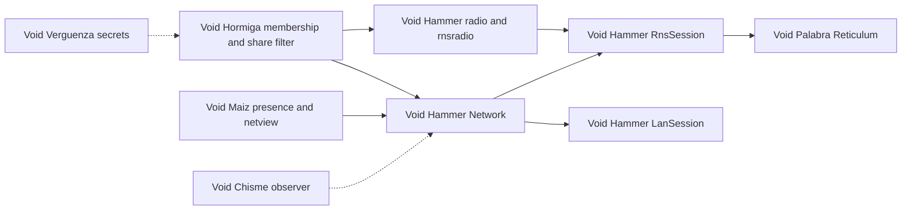

# Void Hormiga — networking library investigation (2026-10-18)

**Status: executed 2026-10-18.** The audit, the durable map, the documentation
corrections and the upstream messages are complete. Source, CMake, Android
build and CI behaviour were not changed; the deltas are H1–H14 in
[the audit report](../okf/reports/networking-stack-audit-2026-10-18.md) and await
approval.

## Purpose

Void Maiz has moved its networking engine to Void Hammer and gained several
adjacent capabilities. Void Palabra, Void Chisme and Void Verguenza have also
moved. Void Hormiga must find out, precisely and with evidence, what is true
today before changing anything.

The output is a dated map of the current stack, a delta list for Hormiga, a
decision memo, and any upstream messages that follow from it.

## Scope

**In scope**

- The networking chain: presence and view surfaces → sync engine → transport →
  Reticulum, including LAN, radios, joining and file transfer.
- What Void Hammer, Void Palabra, Void Maiz, Void Chisme and Void Verguenza
  currently own, expose and have actually built.
- Hormiga's build, CI, Android and desktop wiring for that chain.
- Security and privacy consequences, especially the room-key model against
  Reticulum announces.
- The documentation that currently states the old ownership.

**Adjacent, investigated but not automatically adopted**

- `voidmaiz/nav.hpp` — Hormiga's navigation bar, now lifted upstream.
- `voidmaiz/http.hpp` — the HTTP seam used by the update client.
- `voidmaiz/update.hpp` and `voidmaiz/updateview.hpp` — the update client
  migration tracked by Q86.
- The portable `maiz::App` / `maiz::Device` shell and `maiz_add_app`.
- Void Verguenza's client seam and Void Chisme's observer role.

**Out of scope**

- Implementing a transport change.
- Buying or testing field hardware.
- Rewriting the application shell in this phase.
- Touching any real organization's database.

## What is already known

These are preliminary findings from reading the trees on 2026-10-18. Each must
be re-measured during the investigation before it is treated as final.

1. **The engine moved on 2026-10-17.** Void Hammer now owns reaching devices
   and the sync engine: `voidhammer_reach` (sockets, LAN facts, multicast lock,
   radios) and `voidhammer_net` (`Network`, `LanSession`, `RnsSession`, radio
   bridge). Void Maiz keeps what networking *looks like*. See
   [`VoidHammer networking`](../../VoidHammer/okf/concepts/networking.md:18)
   and the move in
   [`Void Maiz networking`](../../VoidMaiz/okf/concepts/networking.md:10).
2. **Hormiga still builds by compatibility only.** `CMakeLists.txt` links
   [`voidmaiz_lan`](../CMakeLists.txt:102) and
   [`voidmaiz_net`](../CMakeLists.txt:110), and sources include
   [`voidmaiz/lan.hpp`](../src/sync/peer.cpp:9),
   [`voidmaiz/net.hpp`](../src/app/lan_share.hpp:29),
   [`voidmaiz/radio.hpp`](../src/app/lan_radio.cpp:42) and
   [`voidmaiz/rnsradio.hpp`](../src/app/lan_radio.cpp:46). Those now forward to
   `voidhammer/*`, but Hormiga has not adopted the new names.
3. **Void Hammer is not a declared sibling.** README, AGENT-GUIDE, the CI and
   release workflows, and the Android CMake list Void Maiz and Void Palabra but
   not Void Hammer. CI currently builds without networking until Hammer has a
   public repository.
4. **The default LAN sync is still Hormiga's sealed session.** `sync/peer.*`
   and `app/lan_wire.*` carry the frames; the room key, short authentication
   string and sealed presence are Hormiga's. `maiz::Network` is the sync seam on
   top. See [`lan-sharing`](../okf/concepts/platform/lan-sharing.md:189) and
   [`collaboration`](../okf/concepts/platform/collaboration.md:96).
5. **The radios already use Reticulum, but not through `RnsSession`.** Hormiga
   drives `voidpalabra::reticulum::Node` and `maiz::RadioBridge` directly, with
   its own HZP1 room-key proof. `RnsSession` exists in Void Hammer and is the
   library's general answer.
6. **`RnsSession` announces names in the clear.** `about_json` carries display
   name, colour and the shared database's name. That conflicts with Hormiga's
   sealed presence and is already Q98. See
   [`Q98`](../okf/developer_questions.md:118) and
   [`Void Hammer rnslink`](../../VoidHammer/net/src/rnslink.cpp:58).
7. **Void Maiz now has the navigation bar.** `voidmaiz/nav.hpp` is Hormiga's bar
   lifted, with `CentreFace`, a multi-platform `back_pressed` that claims Back,
   and `Stack(root)`. Hormiga's own
   [`src/phone/nav.hpp`](../src/phone/nav.hpp:1) says it was written to be
   lifted.
8. **The portable app shell is a separate, larger migration.** `maiz::App`,
   `maiz::Device` and `maiz_add_app` would replace Hormiga's Android shell and
   is the iOS path. It also removes `curl` and `system()` from host code.
9. **Void Palabra is compatible and current.** Reticulum, pipes, runtime
   interfaces and the entropy fix are built. No breaking change was found in
   this first read.
10. **Void Chisme and Void Verguenza are not integration-ready.** Chisme has a
    phase-0 library and CLI; the observer role and Reticulum phase are later.
    Verguenza has a working single-device desktop vault; the client seam Hormiga
    needs is phase 2.
11. **The docs are already drifting.** Several pages still say Void Maiz owns
    reaching a device, or name `voidmaiz_net`, or describe the radios as
    `voidmaiz/radio.hpp`. The index's project pages still call Chisme and
    Verguenza design-only.

## Ownership today

| owner | what it owns now | code |
|---|---|---|
| Void Hammer | reaching devices and the sync engine, plus hardware knowledge | `VoidHammer/net/` |
| Void Maiz | what networking looks like: presence, marks, claims, wires, session panels, navigation | `voidmaiz/presence.hpp`, `claims.hpp`, `netview.hpp`, `wires.hpp`, `nav.hpp` |
| Void Palabra | what crosses: sync, merge, stream envelope, Reticulum | `VoidPalabra/` |
| Void Chisme | watching and managing a running network | `VoidChisme/` |
| Void Verguenza | shared secrets and approvals | `VoidVerguenza/` |
| Void Hormiga | who may join, what may leave, the database itself | this repository |

## Workstreams

### W1 — Baseline and inventory

Record sibling versions and commits, configure and build the current tree,
run the full suite, and capture the networking configuration that was actually
compiled. Produce a table of every include, target and doc statement that still
names the old ownership.

### W2 — Void Hammer audit

Read the source and OKF for `voidhammer_reach` and `voidhammer_net`. Establish:
the API of `Network`, `LanSession`, `RnsSession`, `RadioBridge` and the radio
holiday; what joining, Allow, `already_allowed`, resync and transfer progress
do today; which tests pass and what they prove; Q7–Q11 and their owners.

### W3 — Void Palabra audit

Confirm the API and version Hormiga compiles against, the Reticulum companion,
pipes and runtime interfaces, and the identity/entropy guarantees. Identify any
change needed for Hormiga to consume `RnsSession` without copying sync logic.

### W4 — Void Maiz audit

Separate what stayed from what moved. Verify presence, `netview`, claims and
wires are unchanged. Assess `nav.hpp`, `http.hpp`, the update client and the
portable shell as independent adoption candidates.

### W5 — Neighbour audit

For Void Chisme, establish whether its library, CLI or observer design can
consume Hormiga today, and what Hormiga must expose first. For Void Verguenza,
establish the client seam's status and the exact blocker for the Antfarm Key
node.

### W6 — Impact, security and mobile

Map each delta to Hormiga code. In particular, compare the room-key model with
Reticulum announces, verify who can discover a database, decide whether a
member can be recognised without leaking a name, and review the Android
multicast lock, radio permissions, the iOS multicast wall and Bonjour.

## Deliverables

1. **A dated map** at `okf/concepts/platform/networking-stack.md`: owners,
   current APIs, what Hormiga uses, what is stale, and the upgrade path.
2. **An evidence report** at `okf/reports/networking-stack-audit-2026-10-18.md`:
   commands, versions, test counts, measurements, and confidence per claim.
3. **A delta ledger** classifying every finding as: no-op, adopt directly,
   needs an upstream change, or declined with a reason.
4. **A decision memo** covering the transport direction, navigation adoption,
   portable shell, update client, and neighbour integration.
5. **Upstream messages** to Void Hammer, Void Palabra, Void Maiz, Void Chisme or
   Void Verguenza for anything that needs their work.
6. **Updated stale documentation**, including the index, LAN sharing,
   collaboration, radios, mobile, the Void Maiz uptake page, the project pages,
   README, AGENT-GUIDE, CI/release sibling lists and the Android CMake.
7. **A log entry** in `okf/log.md` recording what was measured and what was
   decided.

## Decision gates

- **Gate A — transport direction.** After W2, W3 and W6: keep the sealed LAN
  session as default, adopt `RnsSession`, or run both behind an explicit
  transport choice. The lean, pending evidence, is to keep the seal until the
  announce privacy question is answered and membership proof is preserved.
- **Gate B — adjacent adoptions.** After W4: navigation bar now, portable shell
  later, update client with consent migration, HTTP seam as part of the update
  work.
- **Gate C — implementation sequence.** After the report and ledger: approve the
  order, the tests, and the upstream asks.

## Guardrails

- No build or behaviour change until the baseline is recorded.
- Do not remove the old targets or forwarding headers; upstream keeps them and
  Hormiga may need them while the move is in progress.
- Do not regress presence privacy to gain Reticulum discovery.
- Do not let CI silently build without networking and report green as if the
  networking path were tested.
- Never run measurements against an organization's real database; use the Cat
  Colony or a scratch copy.
- Report measurements, not assumptions. Every claim in the new map carries
  `measured`, `verified` or `asserted`.

## Todo

- [x] W1: record sibling versions and commits; build and test the current tree
- [x] W1: inventory every old include, target, CI clone and doc statement
- [x] W2: audit Void Hammer APIs, tests and open questions
- [x] W3: audit Void Palabra compatibility and Reticulum session contract
- [x] W4: audit Void Maiz for what stayed and the adjacent candidates
- [x] W5: audit Void Chisme and Void Verguenza integration prerequisites
- [x] W6: review transport privacy, membership proof and mobile constraints
- [x] Produce the delta ledger with risk and recommended order
- [x] Write the dated networking stack map and evidence report
- [x] Update stale OKF pages, indexes and the log
- [x] Update README, AGENT-GUIDE, CI and Android dependency notes
- [x] Draft upstream messages and present the decision memo
